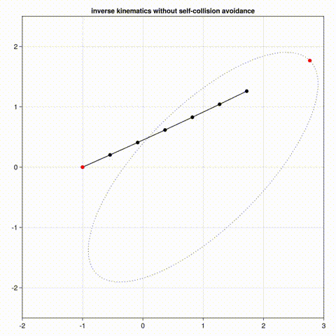
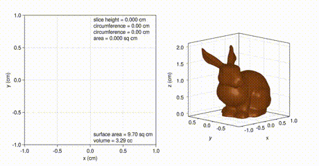
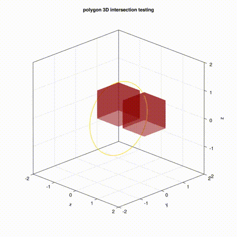
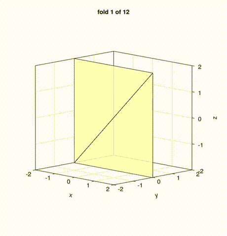

# ripga
# ripga: Projective Geometric Algebra for High-Performance Spatial Computing in Julia

> *"As long as Algebra and Geometry were separated, their progress was slow and their use limited; but once these sciences were united, they lent each other mutual support and advanced rapidly together towards perfection."* — **Joseph-Louis Lagrange (1736–1813)**

**What if you never had to debug a $4\times4$ transformation matrix, untangle gimbal lock, or write special-case intersection logic again?**

**ripga** (Reference Implementation of Projective Geometric Algebra)
- brings the unifying power of **Projective Geometric Algebra (PGA)** to the **Julia** ecosystem,
- treats points, lines, and planes as first-class algebraic citizens, and
- unifies rotations, translations, forces, and torques into single operators.

`ripga` lets you write complex 2D, 3D, and 4D kinematics, CAD kernels, and physics engines in a fraction of the code, paired with **Julia's** native speed and **Makie's** GPU-accelerated rendering, `ripga` turns intricate geometric theory into easily maintained
applications.

---

# <a id="tldr"></a>0. Showcase: PGA in Action

Below are applications built with `ripga` and [Makie](https://docs.makie.org/stable), demonstrating how PGA collapses hundreds of lines of traditional vector/matrix boilerplate into clean, expressive algebra. *(Inspired by Steven De Keninck's
[ganja.js](https://bivector.net) examples, engineered for native execution in Julia).*

<table>
  <tr>
    <td width="50%"></td>
    <td width="50%"></td>
  </tr>
  <tr>
    <td><b><a href="https://enkimute.github.io/ganja.js/examples/coffeeshop.html#pga2d_inverse_kinematics">Real-Time Inverse Kinematics</a></b><br/>Effortless robotic joint chain solving using unified PGA motors — no Jacobian matrix headaches required.</td>
    <td><b><a href="https://enkimute.github.io/ganja.js/examples/coffeeshop.html#pga3d_slicing">3D CAD Mesh Slicing</a></b><br/>Intersecting arbitrary 3D polyhedra with moving planes using a single regressive/outer product operator.</td>
  </tr>
  <tr>
    <td></td>
    <td></td>
  </tr>
  <tr>
    <td><b><a href="https://enkimute.github.io/ganja.js/examples/coffeeshop.html#pga2d_separating_axis">3D Collision Detection (SAT)</a></b><br/>Full 3D Separating Axis Theorem polyhedron collision detection expressed directly through geometric primitives.</td>
    <td><b><a href="https://enkimute.github.io/ganja.js/examples/coffeeshop.html#pga2d_origami">Procedural 3D Origami Folding</a></b><br/>Complex coupled reflections and rotations around arbitrary crease lines in 3D space using sandwich products (`>>>`).</td>
  </tr>
</table>

# Reference Implementation of Projective Geometric Algebra

<summary><b>Table of Contents</b></summary>

- <a href="#tldr">0. Showcase: PGA in Action</a>
- <a href="#why-pga">1. Why Build Applications with PGA and Julia?</a>
- <a href="#hang-of-pga">2. Getting the Hang of PGA</a>
- <a href="#pga-basis">3. PGA Basis</a>
  - <a href="#pga-basis-1d">3.1 1D PGA Basis</a>
  - <a href="#pga-basis-2d">3.2 2D PGA Basis</a>
  - <a href="#pga-basis-3d">3.3 3D PGA Basis</a>
  - <a href="#pga-basis-4d">3.4 4D PGA Basis</a>
- <a href="#pga-exp">4. PGA Exponential</a>
- <a href="#plot">5. Plotting</a>
- <a href="#geo">6. Euclidean Geometry</a>
  - <a href="#geo-1d">6.1 1D Euclidean Geometry</a>
  - <a href="#geo-2d">6.1 2D Euclidean Geometry</a>
  - <a href="#geo-3d">6.1 3D Euclidean Geometry</a>
  - <a href="#geo-4d">6.1 4D Euclidean Geometry</a>
- <a href="#rbd">7. Rigid Body Dynamics</a>
- <a href="#max-eq">8. Maxwell's Equations</a>
- <a href="#conc">9. Conclusion</a>

# <a id="why-pga"></a>1. Why Build Applications with PGA and Julia?

For decades, 3D graphics, robotics, and physics engines have relied on a patchwork of 19th-century math: 3D vectors for positions, $4\times4$ homogeneous matrices for translations, quaternions for rotations, and Plücker coordinates for lines. 

**Projective Geometric Algebra ($\mathbb{R}^*_{n,0,1}$) replaces that entire fragmented toolkit with a single, unified algebra.**

| Application Challenge | Traditional Linear Algebra | PGA |
| :--- | :--- | :--- |
| **Primitives** | Only vectors exist; lines and planes require ad-hoc structs and parametric equations. | **Points, lines, and planes** are native algebraic variables. |
| **Intersections (Meet & Join)** | Dozens of lines of conditional trigonometry and edge-case checks (e.g., parallel lines). | **One operator (`^` or `&`)** computes intersections and spans across all dimensions, naturally handling points at infinity. |
| **Rigid Body Motion** | Separate math for $3\times3$ rotations, quaternions, and $4\times1$ translation offsets. | **Universal Motors:** Rotations and translations are unified. Everything moves via the sandwich product: `M >>> X`. |
| **Physics & Dynamics** | Linear force ($F$) and angular torque ($\tau$) are tracked and integrated separately. | **Forques & Momenta:** Force and torque unify into a single bivector; linear and angular velocity unify into a single twist. |
| **Curvature & Space** | Locked into flat Euclidean assumptions; requires total rewrites for spherical/hyperbolic space. | **Metric Agnostic:** Switch seamlessly between Euclidean ($\mathbb{R}_{3,0,1}$), Elliptic ($\mathbb{R}_{4,0,0}$), and Hyperbolic ($\mathbb{R}_{3,1,0}$) spaces. |

### Proven in Mission-Critical Engineering
More concise math directly translates to **faster R&D cycles, fewer edge-case bugs, and drastically lower technical debt.** In [this industry keynote](https://www.youtube.com/watch?v=_3WPLawT-H0), Dr. Todd Ell, Senior Technical Fellow at **Collins Aerospace** (one of the world's largest aerospace suppliers, employing 16,700+ engineers), details why he is training aerospace engineers to replace traditional linear algebra with Geometric Algebra for mission-critical design and development.

While [bivector.net](https://bivector.net) offers PGA reference implementations for C++, Rust, Python, and JS, **Julia was practically born for Geometric Algebra.** `ripga` leverages Julia's unique strengths to create an unmatched prototyping and production environment:

1. **Solving the Two-Language Problem:** Prototype geometric algorithms interactively in the REPL and execute them at C/C++ speeds with GPU-accelerated [GLMakie](https://docs.makie.org/stable/) visualizations.
2. **First-Class Unicode & Metaprogramming:** Write code using standard ASCII operators (`a ^ b`, `a & b`, `a >>> b`) or use the `@ga` string macro to write literal textbook math syntax ($a \wedge b$, $a \vee b$, $a \cdot b$).
3. **Zero-Boilerplate Multivector Ergonomics:** Instead of wrapping arrays in heavy custom structs, `ripga` overloads vector operators directly onto native Julia `Float32` arrays (`Matrix{Float32}` / `Vector{Float32}`).

| Math Syntax | PGA Operation | `ripga` Code Syntax | What It Does in Your App |
| :--- | :--- | :--- | :--- |
| $ab$ | Geometric Product | `a * b` | Composes reflections and rigid-body motors |
| $a \wedge b$ | Outer Product (Wedge) | `a ^ b` | **Meet:** Intersects planes into lines, or lines into points |
| $a \vee b$ | Regressive Product (Vee) | `a & b` | **Join:** Spans points into lines, or lines into planes |
| $a \cdot b$ | Inner Product (Dot) | `a \| b` | Computes angles, distances, and orthogonal projections |
| $a^*$ | Dual | `!a` | Switches between plane-based and point-based representations |
| $ab\tilde{a}$ | Sandwich Product | `a >>> b` | Applies any rotation, translation, or reflection `a` to object `b` |

> [!TIP]
> **Design Philosophy on Operator Overloading ("Type Squatting"):**
> Julia's style guide generally discourages overloading base operators on standard `Vector` types ("type piracy") to avoid breaking external packages. However, standard Julia does not define bitwise/logical infix operators like `&`, `|`, or `>>>` on `Vector{Float32}`—they don't even compile in base Julia. By claiming these unused operator slots ("type squatting"), `ripga` achieves zero-wrapper performance and seamless compatibility with Makie and linear algebra buffers. *(If you'd like to explore a custom-struct fork for strict package isolation, PRs and comparisons are warmly welcomed!)*

# <a id="hang-of-pga"></a>2. Getting the Hang of PGA
There are three perspectives that contribute to understanding PGA:

## 2.1 History
Reading a description of the historical contributions to the development of PGA by individual mathematicians builds confidence in the
underlying concepts. I particularly like [Slehar's historical description of Clifford algebra](https://slehar.wordpress.com/2014/03/18/clifford-algebra-a-visual-introduction/)
followed by [Slehar's explanation of how Clifford algebra extends to Projective Geometry](https://slehar.wordpress.com/2014/06/26/geometric-algebra-projective-geometry/).

## 2.2 Nomenclature
In PGA, simple geometric objects (e.g., points, lines, planes) are written as PGA expressions. Those geometric objects are manipulated
(e.g., translated or rotated) by performing PGA operations (e.g., geometric product or outer product) on them. PGA expressions are
[linear combinations](https://en.wikipedia.org/wiki/Linear_combination) of PGA basis vectors. There is one PGA basis vector for each
perpendicular axis in the underlying space, which is defined by the [metric signature](https://en.wikipedia.org/wiki/Metric_signature)
typically written as $\mathbb{R}\_{positive,negative,zero}$, where the signature's three subscripts are the number of PGA basis vectors that
square to +1, -1, and 0, respectively. For example, the metric signature for doing PGA in an n-dimensional [Euclidean space](https://en.wikipedia.org/wiki/Euclidean_space)
is $\mathbb{R}\_{n,0,1}^*$, where n is the number of Euclidean dimensions (which is also the number of Euclidean basis vectors in the PGA basis)
and the 1 as the last of the three subscripts denotes the single ideal basis vector that squares to 0. That ideal basis vector is also known as the
null basis vector e0. The n Euclidean basis vectors in an n-dimensional Euclidean space $\mathbb{R}^\*\_{n,0,1}$ are called e1, e2, ..., en.

In addition to the rules in the metric signature defining how the PGA basis vectors square, there is one more important rule:
[the contraction axiom](https://www.youtube.com/watch/v=tX4H_ctggYo&t=3293s), which defines how the sign changes with the order of
PGA basis vectors in the geometric product. For example, ei\*ej = -ej\*ei. As a notational convenience, the geometric operator is often implied (e.g.,
ei\*ej = eiej) and as a further convenience the subsequent e's after the first are also implied (e.g., eiej = eij).

The n Euclidean basis vectors and the one ideal basis vector are said to have grade-1 because they are generated from a single PGA basis vector (e.g., e2).
The PGA basis also contains elements of grades other than grade-1. Grade-n elements of the PGA basis are generated from n PGA basis vectors. For example,
grade-2 elements in the PGA basis are called bivectors (e.g., e12 = e1e2) and grade-3 elements in the PGA basis are called trivectors (e.g., e012 = e0e1e2).
Because each PGA basis element can be represented by a vector, a PGA basis can be thought of as a vector of vectors. However, to avoid ambiguity about
the meaning of "vector", the phrase "PGA basis vector" in this essay will be reserved for just the grade-1 PGA basis elements and the phrases "PGA basis
bivector" and "PGA basis trivector" will be reserved for grade-2 and grade-3 PGA basis elements, respectively. Arbitrary grade PGA basis elements of an
arbitrary grade are just called "PGA basis elements". (More on the PGA basis elements in the next section of this essay.)

For the metric signature $\mathbb{R}^\*\_{n,0,1}$, there are a total of $2^{n+1}$ PGA basis elements according to the [rule of product](https://wikipedia.org/wiki/Rule_of_product).
Those $2^{n+1}$ PGA basis elements are distributed across n+2 grades (i.e., grade-0 through grade n+1), each with $\binom{n+1}{grade}$ PGA basis elements per grade, according to
[Pascal's triangle](https://wikipedia.org/wiki/Pascal's_triangle) from [combinatorics](https://en.wikipedia.org/wiki/Combinatorics). For example in 3D PGA, there are a total of
16 (i.e., $2^{3+1}$) PGA basis elements: 
* 1 grade-0 (i.e., the scalar),
* 4 grade-1 (i.e., e0, e1, e2, e3),
* 6 grade-2 (i.e., e01, e02, e03, e12, e31, e23),
* 4 grade-3 (i.e., e021, e013, e032, e123), and
* 1 grade-4 (i.e., e0123).

## 2.3 Geometric Interpretation
Recalling that the three subscripts of the metric signature $\mathbb{R}\_{positive,negative,zero}$ specify how many PGA basis vectors square to +1,
-1, and 0, respectively, you may have noticed that the metric signature for PGA in an n-dimensional Euclidean space (i.e., $\mathbb{R}^\*\_{n,0,1}$)
has an asterisk. The asterisk specifies the geometric interpretation of the PGA basis:
* with the asterisk, the geometric interpretation is "plane-based", and
* without the asterisk the geometric interpretation is "point-based".

For most people familiar with linear algebra, the geometric interpretation is the most confusing of the three perspectives needed to fully appreciate
PGA. Because plane-based PGA offers several advantages (e.g., universal rotors) over point-based PGA, plane-based PGA is used much more often than
point-based PGA. If the plane-based/point-based qualifier is missing, it is usually safe to assume the intent was plane-based PGA.

In 3D plane-based PGA,
* a grade-1 PGA basis element (e.g., e1) represents a plane,
* a grade-2 PGA basis element (e.g., e12) represents a line, and
* a grade-3 PGA basis element (e.g., e123) represents a point.

In contrast, in 3D point-based PGA,
* a grade-1 PGA basis element (e.g., e1) represents a point,
* a grade-2 PGA basis element (e.g., e12) represents a line, and
* a grade-3 PGA basis element (e.g., e123) represents a plane.

(More on the geometric interpretations in the next section.)

# <a id="pga-basis"></a>3. PGA Basis
The ripga library is capable of switching back and forth between the bases for 1D PGA, 2D PGA, 3D PGA, and 4D PGA.

## <a id="pga-basis-1d"></a>3.1 1D PGA Basis
To prepare Julia's REPL for 1D PGA, include the files ripgand.jl and ripga1d.jl. To confirm the initialization, print out the basis.
```
julia> include("ripgand.jl"); # utility functions for all available dimensions

julia> include("ripga1d.jl"); # enable 1D PGA

julia> basis
4×2 Matrix{String}:
 "1"    "#1: scalar (specified as eu in vector form)"
 "e0"   "#2: ideal point (the point at infinity)"
 "e1"   "#3: Euclidean point at origin (x=0)"
 "e01"  "#4: pseudoscalar (the entire 1D space and the translation bivector)"
```
With a longer command, the REPL displays that basis without the quotation mark clutter.
```
julia> foreach(row->println(join(row, "\t")), eachrow(basis))
1       #1: scalar (specified as eu in vector form)
e0      #2: ideal point (the point at infinity)
e1      #3: Euclidean point at origin (x=0)
e01     #4: pseudoscalar (the entire 1D space and the translation bivector)
```
In 1D PGA, there are a total of four (i.e., $2^{1+1}$) PGA basis elements:
* 1 grade-0 (i.e., the scalar),
* 2 grade-1 (i,e., e0, e1), and
* 1 grade-2 (i.e., e01).

### 3.1.1 Calculating 1D PGA Dual
Because the concept of duality is at the core of the geometric interpretation of PGA, becoming familiar with the two steps
to calculate the dual of the basis can be helpful. The two steps are
1. extend the grade of each PGA basis element to the grade of the pseudoscalar,
2. repeatedly apply the contraction axiom (i.e., eij = -eji) to adjust the index ordering in each extended PGA basis element
   to match the index ordering in the pseudoscalar,

although those two steps can be accomplished in several different ways.

The first of the three approaches is conceptually the easiest because it uses the geometric product to expand the grade of each
PGA basis element (step 1) and that same geometric product automatically corrects the index order of each expanded PGA basis
element (step 2). However, this first approach is not the easiest to implement because it requires an implementation of the
geometric product.

Note that in this first approach, a short cut is to put all the PGA basis elements into a single matrix so
that the geometric product can be done just once (with geoprodset()) instead of on each of the four PGA basis elements. Also,
instead of listing the name of each of the four PGA basis elements within a matrix, a Julia comprehension constructs that matrix
(i.e., [Float32(i == j) for i in 1:5, j in 1:4] == [eu e0 e1 e01]). Although this Julia comprehension doesn't save much typing
with the 1D PGA basis elements, it does save typing when constructing matrices that include all the PGA basis elements for 3D PGA
and 4D PGA.
```
julia> I = [Float32(i == j) for i in 1:size(basis,1)+1, j in 1:size(basis,1)] # Identity matrix (with an appended row for status)
5×4 Matrix{Float32}:
 1.0  0.0  0.0  0.0
 0.0  1.0  0.0  0.0
 0.0  0.0  1.0  0.0
 0.0  0.0  0.0  1.0
 0.0  0.0  0.0  0.0

julia> P = geoprodset(I,reverse(I,dims=2))[size(basis,1),:] # a vector with all the Pseudoscalars
4-element Vector{Float32}:
  1.0
  1.0
 -1.0
  1.0

julia> S = [p < 0 ? "-" : "" for p in P] # a Sign vector of strings
4-element Vector{String}:
 ""
 ""
 "-"
 ""

julia> [basis[:,1] S.*reverse(basis[:,1])] # the 1D PGA basis (col 1) and its dual (col 2)
4×2 Matrix{String}:
 "1"    "e01"
 "e0"   "e1"
 "e1"   "-e0"
 "e01"  "1"
```
The second approach to calculating the dual of the PGA basis is perhaps the quickest because it is performed by a single
call to the utility function basis_dual(basis[:,1]). Looking at the code, basis_dual() does not use the geometric product
to expand each PGA basis element to the grade of the pseudoscalar element (step 1). Instead, that expansion is done with
the concatenation of strings. Then an insertion sort algorithm orders the indices.
```
julia> basis_dual(basis[:,1])
4×2 Matrix{String}:
 "1"    "e01"
 "e0"   "e1"
 "e1"   "-e0"
 "e01"  "1"
```
The third and final approach to calculating the dual of the PGA basis is neither the easiest or the quickest but it may be
the best approach to becoming familiar with PGA's duality. Specifically, this third approach is manual calculation, using
paper and pencil to write a table with four columns:
* column 1: the basis
* column 2: reverse(basis)
* column 3: the number of left shifts to move the 0 index to the first position
* column 4: the number of left shifts to move the 1 index to the second position.
```
julia> [basis[:,1] reverse(basis[:,1]) [0 0;0 0;1 0;0 0]]
4×4 Matrix{Any}:
 "1"    "e01"  0  0
 "e0"   "e1"   0  0
 "e1"   "e0"   1  0
 "e01"  "1"    0  0
```
Then, for a given row of the table (i.e., a given PGA basis element), sum the total number of left shifts (i.e., sum the
counts in columns 3 and 4). If that sum is odd (i.e., the contraction axiom was applied an odd number of times), prepend a
negative sign to the entry in column 2 (the reverse(basis)). The new column 2 is the 1D PGA dual.

### 3.1.2 Calculating 1D PGA Reverse
Similar to the PGA dual (!), which is central to the geometric interpretation of PGA basis elements, the PGA reverse (\~),
which is central to the PGA sandwich operation (e.g., T*P0*~T or equivalently T>>>P0 translates point P0 with translation motor
T). Like the PGA dual (!), the PGA reverse (\~) also is computed in two steps:
1. reverse the order of the indices in each PGA basis element,
2. repeatedly apply the contraction axiom (i.e., eij = -eji) to restore the original (i.e., unreversed) index ordering
   in each PGA basis element.

As with the PGA dual (!), there are different ways to calculate the PGA reverse (\~).

The quickest approach to calculating the PGA reverse (\~) is to call the utility function basis_reverse(basis[:,1]).
```
julia> basis_reverse(basis[:,1])
4×2 Matrix{String}:
 "1"    "1"
 "e0"   "e0"
 "e1"   "e1"
 "e01"  "-e01"
```
The alternative approach to calculating the PGA reverse (\~) is a manual calculation with paper and pencil, which is not
the quickest approach but may be the best approach to gain familiarity with the PGA reverse. Specifically, this manual
calculation involves writing a table with up to three columns:
* column 1: the grade of each length of PGA basis element (e.g., e01 has grade 2)
* columns 2... : column 1 repeatedly decremented to 0 (e.g., e01 has 3 column: 2 1 0) 

The decrementing columns denote the reversed positions (not the values) of the PGA basis element's indices where 0 denotes
the leftmost position, 1 denotes the second leftmost position, etc. Numbering the positions starting at 0 (i.e., leftmost)
causes the decrementing columns to also be the number of left shifts required to restore the values to their initial positions.
Therefore, summing over each row starting at column 2 determines the number of left shifts (i.e., the number Of applications of
the contraction axiom) that were needed to restore the reversed PGA basis element to its original index ordering. If that total
number of left shifts is odd, a negative sign must be prepended to that PGA basis element to give its reverse.
```
julia> M = [1 0 0;2 1 0] # length and shift count matrix for 1D PGA
2×3 Matrix{Int64}:
 1  0  0
 2  1  0
```
To be clear, the PGA reverse ($\sim$) is different from Julia's reverse() function. The PGA reverse ($\sim$) flips the left to right
order of the indices in each PGA basis element and repeatedly applies the contraction axiom to restore the original index ordering,
adding a sign change if the required number of applications are required. In contrast, Julia's reverse() function flips the top to
bottom order of any column vector. As an aside, Julia's reverse() function acts more like the PGA reverse ($\sim$) when Julia's
reverse() function is applied to a Matrix{Float32} with an additional argument specifying that the reversing needs to be done along
the row dimension (e.g., reverse([e0 e1],dims=2) == [e1 e0]). 

### 3.1.3 Example of 1D PGA Point Translation
According to the [Cartan–Dieudonné theorem](https://en.wikipedia.org/wiki/Cartan%E2%80%93Dieudonn%C3%A9_theorem), every
rigid body transformation is composed of reflections across hyperplanes (i.e., points in 1D, lines in 2D, planes in 3D).
In 1D, a translation is two reflections across two points, as shown in the following REPL session where 
* P1 is a point at x=1,
* P2 is a point at x=6, and
* the motor composed of those two points separated by a distance of 5 translates a point to the right by 10 (i.e., twice
  the separation distance between the two points).

```
julia> P1 = point(1); # Euclidean point x=1

julia> P2 = point(6); # Euclidean point x=6

julia> T = P2*P1; # compose the two reflection TranslatitoStr(T)

julia> toStr(T) # check Translation motor
"1 - 5e01"

julia> P0 = point(0); # Euclidean origin (x=0,y=0)

julia> PX = T*P0*~T; # apply Translation motor to P0 at origin; alternative eq is PX = T>>>P0

julia> toCoord(PX) # resulting translated coordinate (shifted P0 twice distance from P1 to P2)
1-element Vector{Float32}:
 10.0
```
Taking a closer look, the reason that the translation motor in the above REPL session works is because the sandwich
operation is an [orthogonal transformation](https://en.wikipedia.org/wiki/Orthogonal_transformtion) (i.e., the squared
norm of the 1D PGA object is preserved through translation T). Concretely, the squared norm of P0 is e11 = 1 and so is
the squared norm of T*P0*~T = 1 because T*P0*~T = (1-5e01)e12(1+5e01) = e12 + 10e20 and (e12 + 10e20)*e12 + 10e20) = 1.
In other words, the squared norm of the 1D PGA point P0 is preserved through the sandwich operation.

In contrast to that translation using the **plane-based** geometric interpretation of PGA basis elements, an attempt
to do a similar translation using the **point-based** geometric interpretation does not work:
```
julia> P1 = point(1,true); # point-based 1D PGA point at x=1

julia> P2 = point(6,true); # point-based 1D PGA point at x=6

julia> T = P2*P1; # attempt at calculating point-based 1D PGA translation motor

julia> toStr(T)
"6 - 5e01"
```
Recall that the plane-based 1D PGA translation motor was T = 1 - 5e01, which is the exact algebraic form of a 
[dual number](https://en.wikipedia.org/wiki/Dual_number). In contrast, when using the **point-based** geometric
Interpretation, the translation motor is T = 6 - 5e01, which is **not** in the algebraic form of a dual number.
That is a red flag, but let's naively continue with the sandwich operation.
```
julia> P0 = point(0,true); # point-based 1D PGA point of Euclidean origin

julia> PX = T*P0*~T; # naive sandwich operation calculating translated point-based 1D PGA point

julia> toStr(PX)
"36e0"
```
That calculated PX is not in the form of a point-based translated point (i.e., PX = e0 + xe1). Therefore, that
attempt at using a **point-based** geometric interpretation with a 1D PGA translation motor failed. Looking closer
for the cause of the failure, the squared norm of P0 was preserved through the sandwich operation but only in the
trivial sense because the squared norm of P0 collapsed to zero (i.e., e00 = 0) and the squared norm of PX also
collapsed to zero (i.e., PX = 36e0 and PX\*PX = 0).

### 3.1.4 Derivation of 1D PGA Point
(TODO)

## <a id="pga-basis-2d"></a>3.2 2D PGA Basis
To prepare Julia's REPL for 2D PGA, include the files ripgand.jl and ripga2d.jl. To confirm the initialization, print out the basis.
```
julia> include("ripgand.jl"); # utility functions for all available dimensions

julia> include("ripga2d.jl"); # enable 2D PGA

julia> basis
8×2 Matrix{String}:
 "1"     "#1: scalar (specified as eu in vector form)"
 "e0"    "#2: ideal line (line at infinity, encloses the 2D space)"
 "e1"    "#3: y-axis line (i.e., the x=0 line)"
 "e2"    "#4: x-axis line (i.e., the y=0 line)"
 "e01"   "#5: ideal point in y-direction and the y translation bivector"
 "e20"   "#6: ideal point in x-direction and the x translation bivector"
 "e12"   "#7: Euclidean point at origin and the rotation bivector"
 "e012"  "#8: pseudoscalar (the entire 2D space)"
```
With a longer command, the REPL displays that basis without the quotation mark clutter.
```
julia> foreach(row->println(join(row, "\t")), eachrow(basis))
1       #1: scalar (specified as eu in vector form)
e0      #2: ideal line (line at infinity, encloses the 2D space)
e1      #3: y-axis line (i.e., the x=0 line)
e2      #4: x-axis line (i.e., the y=0 line)
e01     #5: ideal point in y-direction and the y translation bivector
e20     #6: ideal point in x-direction and the x translation bivector
e12     #7: Euclidean point at origin and the rotation bivector
e012    #8: pseudoscalar (the entire 2D space)
```
In 2D PGA, there are a total of eight (i.e., $2^{2+1}$) PGA basis elements:
* 1 grade-0 (i.e., the scalar),
* 3 grade-1 (i,e., e0, e1, e2),
* 3 grade-2 (i.e., e01, e20, e12), and
* 1 grade-3 (i.e., e012).

### 3.2.1 Calculating 2D PGA Dual
Because the concept of duality is at the core of the geometric interpretation of PGA, becoming familiar with the two steps
to calculate the dual of the basis can be helpful. The two steps are
1. extend the grade of each PGA basis element to the grade of the pseudoscalar,
2. repeatedly apply the contraction axiom (i.e., eij = -eji) to adjust the index ordering in each extended PGA basis element
   to match the index ordering in the pseudoscalar,

although those two steps can be accomplished in several different ways.

The first of the three approaches is conceptually the easiest because it uses the geometric product to expand the grade of each
PGA basis element (step 1) and that same geometric product automatically corrects the index order of each expanded PGA basis
element (step 2). However, this first approach is not the easiest to implement because it requires an implementation of the
geometric product.

Note that in this first approach, a short cut is to put all the PGA basis elements into a single matrix so
that the geometric product can be called just once (with geoprodset()) instead of on each of the eight PGA basis elements.
Also, instead of listing the name of each of the eight PGA basis elements within a matrix, a Julia comprehension constructs that
matrix (i.e., [Float32(i == j) for i in 1:9, j in 1:8] == [eu e0 e1 e2 e01 e20 e12 e012]). Although this Julia comprehension doesn't
save much typing with the 2D PGA basis elements, it does save typing when constructing matrices that include all the PGA basis
elements for 3D PGA and 4D PGA.

<details>

<summary>Click to expand/collapse the REPL output</summary>

```julia
julia> I = [Float32(i == j) for i in 1:size(basis,1)+1, j in 1:size(basis,1)] # Identity matrix
9×8 Matrix{Float32}:
 1.0  0.0  0.0  0.0  0.0  0.0  0.0  0.0
 0.0  1.0  0.0  0.0  0.0  0.0  0.0  0.0
 0.0  0.0  1.0  0.0  0.0  0.0  0.0  0.0
 0.0  0.0  0.0  1.0  0.0  0.0  0.0  0.0
 0.0  0.0  0.0  0.0  1.0  0.0  0.0  0.0
 0.0  0.0  0.0  0.0  0.0  1.0  0.0  0.0
 0.0  0.0  0.0  0.0  0.0  0.0  1.0  0.0
 0.0  0.0  0.0  0.0  0.0  0.0  0.0  1.0
 0.0  0.0  0.0  0.0  0.0  0.0  0.0  0.0

julia> P = geoprodset(I,reverse(I,dims=2))[size(basis,1),:] # a vector with all the Pseudoscalars
8-element Vector{Float32}:
 1.0
 1.0
 1.0
 1.0
 1.0
 1.0
 1.0
 1.0

julia> S = [p < 0 ? "-" : "" for p in P]  # a Sign vector of strings
8-element Vector{String}:
 ""
 ""
 ""
 ""
 ""
 ""
 ""
 ""

julia> [basis[:,1] S.*reverse(basis[:,1])]
8×2 Matrix{String}:
 "1"     "e012"
 "e0"    "e12"
 "e1"    "e20"
 "e2"    "e01"
 "e01"   "e2"
 "e20"   "e1"
 "e12"   "e0"
 "e012"  "1"
```
</details>

The second approach to calculating the dual of the PGA basis is perhaps the quickest because it is performed by a single
call to the utility function basis_dual(basis[:,1]). Looking at the code, basis_dual() does not use the geometric product
to expand each PGA basis element to the grade of the pseudoscalar element (step 1). Instead, that expansion is done with
the concatenation of strings. Then an insertion sort algorithm orders the indices.
```
julia> basis_dual(basis[:,1])
8×2 Matrix{String}:
 "1"     "e012"
 "e0"    "e12"
 "e1"    "e20"
 "e2"    "e01"
 "e01"   "e2"
 "e20"   "e1"
 "e12"   "e0"
 "e012"  "1"
```
The third and final approach to calculating the dual of the PGA basis is neither the easiest or the quickest but it may be
the best approach to becoming familiar with PGA's duality. Specifically, this third approach is manual calculation, using
paper and pencil to write a table with five columns:
* column 1: the basis
* column 2: reverse(basis)
* column 3: the number of left shifts to move the 0 index to the first position
* column 4: the number of left shifts to move the 1 index to the second position
* column 5: the number of left shifts to move the 2 index to the third position.
```
julia> [basis[:,1] reverse(basis[:,1]) [0 0 0;0 0 0;2 0 0;1 1 0;0 0 0;1 1 0;2 0 0;0 0 0]]
8×5 Matrix{Any}:
 "1"     "e012"  0  0  0
 "e0"    "e12"   0  0  0
 "e1"    "e20"   2  0  0
 "e2"    "e01"   1  1  0
 "e01"   "e2"    0  0  0
 "e20"   "e1"    1  1  0
 "e12"   "e0"    2  0  0
 "e012"  "1"     0  0  0
```
Then, for a given row of the table (i.e., a given PGA basis element), sum the total number of left shifts (i.e., sum the
counts in columns 3, 4, and 5. If that sum is odd (i.e., the contraction axiom was applied an odd number of times), prepend a
negative sign to the entry in column 2 (the reverse(basis)). The new column 2 is the 2D PGA dual.

### 3.2.2 Calculating 2D PGA Reverse
Similar to the PGA dual (!), which is central to the geometric interpretation of PGA basis elements, the PGA reverse (\~),
which is central to the PGA sandwich operation (e.g., T*P0*~T or equivalently T>>>P0 translates point P0 with translation motor
T). Like the PGA dual (!), the PGA reverse (\~) also is computed in two steps:
1. reverse the order of the indices in each PGA basis element,
2. repeatedly apply the contraction axiom (i.e., eij = -eji) to restore the original (i.e., unreversed) index ordering
   in each PGA basis element.

As with the PGA dual (!), there are different ways to calculate the PGA reverse (\~).

The quickest approach to calculating the PGA reverse (\~) is to call the utility function basis_reverse(basis[:,1]).
```
julia> basis_reverse(basis[:,1])
8×2 Matrix{String}:
 "1"     "1"
 "e0"    "e0"
 "e1"    "e1"
 "e2"    "e2"
 "e01"   "-e01"
 "e20"   "-e20"
 "e12"   "-e12"
 "e012"  "-e012"
```
The alternative approach to calculating the PGA reverse (\~) is a manual calculation with paper and pencil, which is not
the quickest approach but may be the best approach to gain familiarity with the PGA reverse. Specifically, this manual
calculation involves writing a table with up to four columns:
* column 1: the grade of length of PGA basis element (e.g., e01 has grade 2)
* columns 2... : column 1 repeatedly decremented to 0 (e.g., e01 has 3 column: 2 1 0) 

The decrementing columns denote the reversed positions (not the values) of the PGA basis element's indices where 0 denotes
the leftmost positiond, 1 denotes the second leftmost position, etc. Numbering the positions starting at 0 (i.e., leftmost)
causes the decrementing columns to also be the number of left shifts required to restore the values to their initial positions.
Therefore, summing over each row starting at column 2 determines the number of left shifts (i.e., the number of applications of
the contraction axiom) that were needed to restore the reversed PGA basis element to its original index ordering. If that total
number of left shifts is odd, a negative sign must be prepended to that PGA basis element to give its reverse.
```
julia> M = [1 0 0 0;2 1 0 0;3 2 1 0]
3×4 Matrix{Int64}:
 1  0  0  0
 2  1  0  0
 3  2  1  0
```
(For details on how PGA reverse differs from Julia's built-in reverse() function, see Section 4.1.2.)

### 3.2.3 Example of 2D PGA Point Translation
According to the [Cartan–Dieudonné theorem](https://en.wikipedia.org/wiki/Cartan%E2%80%93Dieudonn%C3%A9_theorem), every
rigid body transformation is composed of reflections across hyperplanes (i.e., points in 1D, lines in 2D, planes in 3D).
In 2D, a translation is two reflections across parallel lines and a rotation is two reflections across intersecting lines,
as shown in the following REPL where
* L1 is a vertical line, the y-axis,
* L2 is another vertical line, 5 to the right of the y-axis, and
* the motor composed of those two parallel vertical lines separated by a distance of 5 translates a point to the right by 10
  (i.e., twice the distance between the two parallel lines).

```
julia> L1 = point(0,0)&point(0,1); # the x=0 hyperplane is the y-axis

julia> toStr(L1) # e1 is y-axis
"e1"

julia> L2 = point(5,0)&point(5,1); # another vertical line but 5 to the right of L1

julia> toStr(L2) # the join of (5,0) and (5,1) is L1 except shifted right by 5
"-5e0 + e1"

julia> T = L2*L1; # compose the two reflection Translation motor as geometric product

julia> toStr(T) # check Translation motor
"1 - 5e01"

julia> P = point(0,0); # Euclidean origin

julia> toStr(P) # the Euclidean origin for 2D PGA is e12
"e12"

julia> P2 = T*P*~T; # apply Translation motor to P at origin; alternative eq is P2 = T>>>P

julia> toStr(P2) # resulting dual PGA point (xe20+ye01+e12) => Euclidean point (x,y) = (10,0); see cheat sheet
"10e20 + e12"
```
Taking a closer look, the reason that the above translation motor works is because the sandwich
operation is an [orthogonal transformation](https://en.wikipedia.org/wiki/Orthogonal_transformtion) (i.e., the squared
norm of the 2D PGA object is preserved through translation T). Concretely, the squared norm of P is e1212 = -1 and so is
the squared norm of T*P0*~T = -1 because T*P*~T = (1 - 5e01)e12(1 - 5e10) = e12 - 5 e1210 - 5e02 + 25e0210 = e12 and
(T*P*~T)*(T*P*~T) = e1212 = -1. In other words, the squared norm of the 2D PGA point P is preserved through the sandwich
operation.

In contrast to that translation using the **plane-based** geometric interpretation of PGA basis elements, an attempt
to make a translation motor using the **point-based** geometric interpretation fails where
* L1 is still the y-axis but has the 2D **point-based** PGA expression e0^e2 = -e20,
* L2 is still 5 to right of L1 but has the 2D **point-based** PGA expression e0^e2+5e1^e2 = -e20+5e12, and
* the attempt to make a translation motor T = L2*L1 fails because L2*L1 = (-e20+5e12)*(-e20) = 5e01 which is not in the
  correct form (i.e., is not a dual number) to be a translation motor.

Notice how the "meet" operation depends upon the geometric interpretation. In plane-based PGA, the regressive product (i.e.,
the vee operator) performs the "meet" of two points, but in point-based PGA the outer product (i.e., the wedge operation)
performs the "meet" of two points.
```
julia> L1 = point(0,0,true)^point(0,1,true); # in point-based PGA, the wedge operator does a "meet" of two points

julia> toStr(L1) # note: the vee operator (that joings two points in plane-based PGA) would result in a zero vector
"-e20"

julia> L2 = point(5,0,true)^point(5,1,true); # another vertical line 5 to the right of L1

julia> toStr(L2) # the "meet" operation is done by the wedge in point-based PGA but a vee in plane-based PGA
"-e20 + 5e12"

julia> T = L2*L1; # attempt to calculate point-based Translation motor

julia> toStr(T) # not in form of dual number (missing scalar term), so translation will fail
"5e01"
```
### 3.2.4 Derivative of 2D PGA Point
(TODO)

## <a id="pga-basis-3d"></a>3.3 3D PGA Basis
To prepare Julia's REPL for 3D PGA, include the files ripgand.jl and ripga3d.jl. To confirm the initialization, print out the basis.
```
julia> include("ripgand.jl"); # utility functions for all available dimensions

julia> include("ripga3d.jl"); # enable 3D PGA

julia> basis
16×2 Matrix{String}:
 "1"      "# 1 scalar (specified as eu in vector form)"
 "e0"     "# 2 ideal plane (the plane at infinity)"
 "e1"     "# 3 Euclidean yz-plane (i.e., the x=0 plane)"
 "e2"     "# 4 Euclidean zx-plane (i.e., the y=0 plane)"
 "e3"     "# 5 Euclidean xy-plane (i.e., the z=0 plane)"
 "e01"    "# 6 ideal line x and the x translation bivector"
 "e02"    "# 7 ideal line y and the y translation bivector"
 "e03"    "# 8 ideal line z and the z translation bivector"
 "e12"    "# 9 z-axis line and bivector for rotation about z"
 "e31"    "#10 y-axis line and bivector for rotation about y"
 "e23"    "#11 x-axis line and bivector for rotation about x"
 "e021"   "#12 ideal point z (i.e., the point at infinity along z-axis)"
 "e013"   "#13 ideal point y (i.e., the point at infinity along y-axis)"
 "e032"   "#14 ideal point x (i.e., the point at infinity along x-axis)"
 "e123"   "#15 Euclidean point at origin (x=0,y=0,z=0)"
 "e0123"  "#16 pseudoscalar (the entire 3D space)"
```
With a longer command, the REPL displays that basis without the quotation mark clutter.
```
julia> foreach(row->println(join(row, "\t")), eachrow(basis))
1       # 1 scalar (specified as eu in vector form)
e0      # 2 ideal plane (the plane at infinity)
e1      # 3 Euclidean yz-plane (i.e., the x=0 plane)
e2      # 4 Euclidean zx-plane (i.e., the y=0 plane)
e3      # 5 Euclidean xy-plane (i.e., the z=0 plane)
e01     # 6 ideal line x and the x translation bivector
e02     # 7 ideal line y and the y translation bivector
e03     # 8 ideal line z and the z translation bivector
e12     # 9 z-axis line and bivector for rotation about z
e31     #10 y-axis line and bivector for rotation about y
e23     #11 x-axis line and bivector for rotation about x
e021    #12 ideal point z (i.e., the point at infinity along z-axis)
e013    #13 ideal point y (i.e., the point at infinity along y-axis)
e032    #14 ideal point x (i.e., the point at infinity along x-axis)
e123    #15 Euclidean point at origin (x=0,y=0,z=0)
e0123   #16 pseudoscalar (the entire 3D space)
```
In 3D PGA, there are a total of 16 (i.e., $2^{3+1}$) PGA basis elements:
* 1 grade-0 (i.e., the scalar),
* 4 grade-1 (i,e., e0, e1, e2, e3),
* 6 grade-2 (i.e., e01, e02, e03, e12, e31, e23),
* 4 grade-3 (i.e., e021, e013, e032, e123), and
* 1 grade-4 (i.e., e0123).

### 3.3.1 Calculating 3D PGA Dual
Because the concept of duality is at the core of the geometric interpretation of PGA, becoming familiar with the two steps
to calculate the dual of the basis can be helpful. The two steps are
1. extend the grade of each PGA basis element to the grade of the pseudoscalar,
2. repeatedly apply the contraction axiom (i.e., eij = -eji) to adjust the index ordering in each extended PGA basis element
   to match the index ordering in the pseudoscalar,
   
although those two steps can be accomplished in several different ways.

The first of the three approaches is conceptually the easiest because it uses the geometric product to expand the grade of each
PGA basis element (step 1) and that same geometric product automatically corrects the index order of each expanded PGA basis
element (step 2). However, this first approach is not the easiest to implement because it requires an implementation of the
geometric product.

Note that in this first approach, a short cut is to put all the PGA basis elements into a single matrix so
that the geometric product can be called just once (with geoprodset()) instead of on each of the 16 PGA basis elements. Also,
instead of listing the names of each of the 16 PGA basis elements within a matrix, a Julia comprehension constructs that matrix
(i.e., [Float32(i == j) for i in 1:17, j in 1:16] == [eu e0 e1 e2 e3 e01 e02 e03 e12 e31 e23 e021 e013 e032 e123 e0123]).

<details>

<summary>Click to expand/collapse the REPL output</summary>

```julia
julia> I = [Float32(i == j) for i in 1:size(basis,1)+1, j in 1:size(basis,1)] # Identity matrix
17×16 Matrix{Float32}:
 1.0  0.0  0.0  0.0  0.0  0.0  0.0  0.0  0.0  0.0  0.0  0.0  0.0  0.0  0.0  0.0
 0.0  1.0  0.0  0.0  0.0  0.0  0.0  0.0  0.0  0.0  0.0  0.0  0.0  0.0  0.0  0.0
 0.0  0.0  1.0  0.0  0.0  0.0  0.0  0.0  0.0  0.0  0.0  0.0  0.0  0.0  0.0  0.0
 0.0  0.0  0.0  1.0  0.0  0.0  0.0  0.0  0.0  0.0  0.0  0.0  0.0  0.0  0.0  0.0
 0.0  0.0  0.0  0.0  1.0  0.0  0.0  0.0  0.0  0.0  0.0  0.0  0.0  0.0  0.0  0.0
 0.0  0.0  0.0  0.0  0.0  1.0  0.0  0.0  0.0  0.0  0.0  0.0  0.0  0.0  0.0  0.0
 0.0  0.0  0.0  0.0  0.0  0.0  1.0  0.0  0.0  0.0  0.0  0.0  0.0  0.0  0.0  0.0
 0.0  0.0  0.0  0.0  0.0  0.0  0.0  1.0  0.0  0.0  0.0  0.0  0.0  0.0  0.0  0.0
 0.0  0.0  0.0  0.0  0.0  0.0  0.0  0.0  1.0  0.0  0.0  0.0  0.0  0.0  0.0  0.0
 0.0  0.0  0.0  0.0  0.0  0.0  0.0  0.0  0.0  1.0  0.0  0.0  0.0  0.0  0.0  0.0
 0.0  0.0  0.0  0.0  0.0  0.0  0.0  0.0  0.0  0.0  1.0  0.0  0.0  0.0  0.0  0.0
 0.0  0.0  0.0  0.0  0.0  0.0  0.0  0.0  0.0  0.0  0.0  1.0  0.0  0.0  0.0  0.0
 0.0  0.0  0.0  0.0  0.0  0.0  0.0  0.0  0.0  0.0  0.0  0.0  1.0  0.0  0.0  0.0
 0.0  0.0  0.0  0.0  0.0  0.0  0.0  0.0  0.0  0.0  0.0  0.0  0.0  1.0  0.0  0.0
 0.0  0.0  0.0  0.0  0.0  0.0  0.0  0.0  0.0  0.0  0.0  0.0  0.0  0.0  1.0  0.0
 0.0  0.0  0.0  0.0  0.0  0.0  0.0  0.0  0.0  0.0  0.0  0.0  0.0  0.0  0.0  1.0
 0.0  0.0  0.0  0.0  0.0  0.0  0.0  0.0  0.0  0.0  0.0  0.0  0.0  0.0  0.0  0.0

julia> P = geoprodset(I,reverse(I,dims=2))[size(basis,1),:] # a vector with all the Pseudoscalars
16-element Vector{Float32}:
  1.0
  1.0
  1.0
  1.0
  1.0
  1.0
  1.0
  1.0
  1.0
  1.0
  1.0
 -1.0
 -1.0
 -1.0
 -1.0
  1.0

julia> S = [p < 0 ? "-" : "" for p in P]  # a Sign vector of strings
16-element Vector{String}:
 ""
 ""
 ""
 ""
 ""
 ""
 ""
 ""
 ""
 ""
 ""
 "-"
 "-"
 "-"
 "-"
 ""

julia> [basis[:,1] S.*reverse(basis[:,1])]
16×2 Matrix{String}:
 "1"      "e0123"
 "e0"     "e123"
 "e1"     "e032"
 "e2"     "e013"
 "e3"     "e021"
 "e01"    "e23"
 "e02"    "e31"
 "e03"    "e12"
 "e12"    "e03"
 "e31"    "e02"
 "e23"    "e01"
 "e021"   "-e3"
 "e013"   "-e2"
 "e032"   "-e1"
 "e123"   "-e0"
 "e0123"  "1"
```
</details>

The second approach to calculating the dual of the PGA basis is perhaps the quickest because it is performed by a single
call to the utility function basis_dual(basis[:,1]). Looking at the code, basis_dual() does not use the geometric product
to expand each PGA basis element to the grade of the pseudoscalar element (step 1). Instead, that expansion is done with
the concatenation of strings. Then an insertion sort algorithm orders the indices.
```
julia> basis_dual(basis[:,1])
16×2 Matrix{String}:
 "1"      "e0123"
 "e0"     "e123"
 "e1"     "e032"
 "e2"     "e013"
 "e3"     "e021"
 "e01"    "e23"
 "e02"    "e31"
 "e03"    "e12"
 "e12"    "e03"
 "e31"    "e02"
 "e23"    "e01"
 "e021"   "-e3"
 "e013"   "-e2"
 "e032"   "-e1"
 "e123"   "-e0"
 "e0123"  "1"
```
The third and final approach to calculating the dual of the PGA basis is neither the easiest or the quickest but it may be
the best approach to becoming familiar with PGA's duality. Specifically, this third approach is manual calculation, using
paper and pencil to write a table with six columns:
* column 1: the basis
* column 2: reverse(basis)
* column 3: the number of left shifts to move the 0 index to the first position
* column 4: the number of left shifts to move the 1 index to the second position
* column 5: the number of left shifts to move the 2 index to the third position
* column 6: the number of left shifts to move the 3 index to the fourth position.
```
julia> [basis[:,1] reverse(basis[:,1]) [0 0 0 0;0 0 0 0;1 0 1 0;1 1 0 0;1 2 1 0;0 0 0 0;0 2 0 0;0 1 1 0;2 0 0 0;2 1 1 0;2 2 0 0;0 1 0 0;0 0 1 0;0 2 1 0;3 0 0 0;0 0 0 0]]
16×6 Matrix{Any}:
 "1"      "e0123"  0  0  0  0
 "e0"     "e123"   0  0  0  0
 "e1"     "e032"   1  0  1  0
 "e2"     "e013"   1  1  0  0
 "e3"     "e021"   1  2  1  0
 "e01"    "e23"    0  0  0  0
 "e02"    "e31"    0  2  0  0
 "e03"    "e12"    0  1  1  0
 "e12"    "e03"    2  0  0  0
 "e31"    "e02"    2  1  1  0
 "e23"    "e01"    2  2  0  0
 "e021"   "e3"     0  1  0  0
 "e013"   "e2"     0  0  1  0
 "e032"   "e1"     0  2  1  0
 "e123"   "e0"     3  0  0  0
 "e0123"  "1"      0  0  0  0
```
Then, for a given row of the table (i.e., a given PGA basis element), sum the total number of left shifts (i.e., sum the
counts in columns 3, 4, 5, and 6. If that sum is odd (i.e., the contraction axiom was applied an odd number of times), prepend a
negative sign to the entry in column 2 (the reverse(basis)). The new column 2 is the 2D PGA dual.

### 3.3.2 Calculating 3D PGA Reverse
Similar to the PGA dual (!), which is central to the geometric interpretation of PGA basis elements, the PGA reverse (\~),
which is central to the PGA sandwich operation (e.g., T*P0*~T or equivalently T>>>P0 translates point P0 with translation motor
T). Like the PGA dual (!), the PGA reverse (\~) also is computed in two steps:
1. reverse the order of the indices in each PGA basis element,
2. repeatedly apply the contraction axiom (i.e., eij = -eji) to restore the original (i.e., unreversed) index ordering
   in each PGA basis element.

As with the PGA dual (!), there are different ways to calculate the PGA reverse (\~).

The quickest approach to calculating the PGA reverse (\~) is to call the utility function basis_reverse(basis[:,1]).
```
julia> basis_reverse(basis[:,1])
16×2 Matrix{String}:
 "1"      "1"
 "e0"     "e0"
 "e1"     "e1"
 "e2"     "e2"
 "e3"     "e3"
 "e01"    "-e01"
 "e02"    "-e02"
 "e03"    "-e03"
 "e12"    "-e12"
 "e31"    "-e31"
 "e23"    "-e23"
 "e021"   "-e021"
 "e013"   "-e013"
 "e032"   "-e032"
 "e123"   "-e123"
 "e0123"  "e0123"
```
The alternative approach to calculating the PGA reverse (\~) is a manual calculation with paper and pencil, which is not
the quickest approach but may be the best approach to gain familiarity with the PGA reverse. Specifically, this manual
calculation involves writing a table with up to five columns:
* column 1: the grade of each length of PGA basis element (e.g., e01 has grade 2)
* columns 2... : column 1 repeatedly decremented to 0 (e.g., e01 has 3 column: 2 1 0) 

The decrementing columns denote the reversed positions (not the values) of the PGA basis element's indices where 0 denotes
the leftmost position, 1 denotes the second leftmost position, etc. Numbering the positions starting at 0 (i.e., leftmost)
causes the decrementing columns to also be the number of left shifts required to restore the values to their initial positions.
Therefore, summing over each row starting at column 2 determines the number of left shifts (i.e., the number of applications of
the contraction axiom) that were needed to restore the reversed PGA basis element to its original index ordering. If that total
number of left shifts is odd, a negative sign must be prepended to the PGA basis element of that given length.
```
julia> M = [1 0 0 0 0; 2 1 0 0 0; 3 2 1 0 0; 4 3 2 1 0]
4×5 Matrix{Int64}:
 1  0  0  0  0
 2  1  0  0  0
 3  2  1  0  0
 4  3  2  1  0
```
(For details on how PGA reverse differs from Julia's built-in reverse() function, see Section 4.1.2.)

### 3.3.3 Example of 3D PGA Point Translation
According to the [Cartan–Dieudonné theorem](https://en.wikipedia.org/wiki/Cartan%E2%80%93Dieudonn%C3%A9_theorem), every
rigid body transformation is composed of reflections across hyperplanes (i.e., points in 1D, lines in 2D, planes in 3D).
In 3D, a translation is two reflections across parallel planes and a rotation is two reflections across intersecting planes,
as shown in the following REPL where
* p1 is the x=0 plane,
* p2 is the x=5 plane, and
* the motor composed of those two parallel planes separated by a distance of 5 translates a point at P1=(-1,0,0) to P2=(9,0,0),
  a translation of 10 (i.e., twice the distance between the two parallel planes).
```
julia> p1 = e1; # x = 0 plane

julia> p2 = e1 - 5*e0; # x = 5 plane

julia> T = p2*p1; # Translation motor

julia> P1 = point(-1,0,0); # starting point

julia> P2 = T*P1*~T; # ending point, after translation T

julia> toStr(P2)
"9e032 + e123"

julia> toCoord(P2)
3-element Vector{Float32}:
 9.0
 0.0
 0.0
```
### 3.3.4 Derivative of 3D PGA Point
(TODO)

## <a id="pga-basis-4d">3.4 4D PGA Basis
To prepare Julia's REPL for 4D PGA, include the files ripgand.jl and ripga4d.jl. To confirm the initialization, print out the basis.
Note that the 4D PGA basis is long enough for Julia's default REPL output to abbreviate the middle section of the basis.

<details>

<summary>Click to expand/collapse the REPL output</summary>

```julia
julia> include("ripgand.jl")
rtest (generic function with 1 method)

julia> include("ripga4d.jl")
utest (generic function with 3 methods)

julia> basis
32×2 Matrix{String}:
 "1"       "# 1 scalar (specified as eu in vector form)"
 "e0"      "# 2 ideal 3D hyperplane (the 3D hyperplane at infinity)"
 "e1"      "# 3 Euclidean yzw-hyperplane (i.e., the x=0 3D hyperplane)"
 "e2"      "# 4 Euclidean xzw-hyperplane (i.e., the y=0 3D hyperplane)"
 "e3"      "# 5 Euclidean xyw-hyperplane (i.e., the z=0 3D hyperplane)"
 "e4"      "# 6 Euclidean xyz-hyperplane (i.e., the w=0 3D hyperplane)"
 "e01"     "# 7 ideal plane in x=0 hyperplane and x translation bivector"
 "e02"     "# 8 ideal plane in y=0 hyperplane and y translation bivector"
 "e03"     "# 9 ideal plane in z=0 hyperplane and z translation bivector"
 "e04"     "#10 ideal plane in w=0 hyperplane and w translation bivector"
 "e12"     "#11 Euclidean zw-plane (intersection of e1 and e2, for rotations in xy-plane)"
 "e13"     "#12 Euclidean yw-plane (intersection of e1 and e3, for rotations in xz-plane)"
 "e14"     "#13 Euclidean yz-plane (intersection of e1 and e4, for rotations in xw-plane)"
 ⋮
 "e024"    "#21 ideal line in xz-plane for defining directionality within 2D subspaces"
 "e034"    "#22 ideal line in xy-plane for defining directionality within 2D subspaces"
 "e123"    "#23 Euclidean w-line (i.e., intersection of x=0, y=0, z=0 hyperplanes)"
 "e124"    "#24 Euclidean z-line (i.e., intersection of x=0, y=0, w=0 hyperplanes)"
 "e134"    "#25 Euclidean y-line (i.e., intersection of x=0, z=0, w=0 hyperplanes)"
 "e234"    "#26 Euclidean x-line (i.e., intersection of y=0, z=0, w=0 hyperplanes)"
 "e0123"   "#27 ideal point along w-axis for defining absolute direction of w-axis"
 "e0124"   "#28 ideal point along z-axis for defining absolute direction of z-axis"
 "e0134"   "#29 ideal point along y-axis for defining absolute direction of y-axis"
 "e0234"   "#30 ideal point along x-axis for defining absolute direction of x-axis"
 "e1234"   "#31 Euclidean origin (i.e., coordinate at (0,0,0,0))"
 "e01234"  "#32 pseudoscalar (the entire 4D space)"
```
</details>

With a longer command, the REPL displays the emtire basis without abbreviating the middle
of the basis.

<details>

<summary>Click to expand/collapse the REPL output</summary>

```julia
julia> foreach(row->println(join(row, "\t")), eachrow(basis))
1       # 1 scalar (specified as eu in vector form)
e0      # 2 ideal 3D hyperplane (the 3D hyperplane at infinity)
e1      # 3 Euclidean yzw-hyperplane (i.e., the x=0 3D hyperplane)
e2      # 4 Euclidean xzw-hyperplane (i.e., the y=0 3D hyperplane)
e3      # 5 Euclidean xyw-hyperplane (i.e., the z=0 3D hyperplane)
e4      # 6 Euclidean xyz-hyperplane (i.e., the w=0 3D hyperplane)
e01     # 7 ideal plane in x=0 hyperplane and x translation bivector
e02     # 8 ideal plane in y=0 hyperplane and y translation bivector
e03     # 9 ideal plane in z=0 hyperplane and z translation bivector
e04     #10 ideal plane in w=0 hyperplane and w translation bivector
e12     #11 Euclidean zw-plane (intersection of e1 and e2, for rotations in xy-plane)
e13     #12 Euclidean yw-plane (intersection of e1 and e3, for rotations in xz-plane)
e14     #13 Euclidean yz-plane (intersection of e1 and e4, for rotations in xw-plane)
e23     #14 Euclidean xw-plane (intersection of e2 and e3, for rotations in yz-plane)
e24     #15 Euclidean xz-plane (intersection of e2 and e4, for rotations in yw-plane)
e34     #16 Euclidean xy-plane (intersection of e3 and e4, for rotations in zw-plane)
e012    #17 ideal line in zw-plane for defining directionality within 2D subspaces
e013    #18 ideal line in yw-plane for defining directionality within 2D subspaces
e014    #19 ideal line in yz-plane for defining directionality within 2D subspaces
e023    #20 ideal line in xw-plane for defining directionality within 2D subspaces
e024    #21 ideal line in xz-plane for defining directionality within 2D subspaces
e034    #22 ideal line in xy-plane for defining directionality within 2D subspaces
e123    #23 Euclidean w-line (i.e., intersection of x=0, y=0, z=0 hyperplanes)
e124    #24 Euclidean z-line (i.e., intersection of x=0, y=0, w=0 hyperplanes)
e134    #25 Euclidean y-line (i.e., intersection of x=0, z=0, w=0 hyperplanes)
e234    #26 Euclidean x-line (i.e., intersection of y=0, z=0, w=0 hyperplanes)
e0123   #27 ideal point along w-axis for defining absolute direction of w-axis
e0124   #28 ideal point along z-axis for defining absolute direction of z-axis
e0134   #29 ideal point along y-axis for defining absolute direction of y-axis
e0234   #30 ideal point along x-axis for defining absolute direction of x-axis
e1234   #31 Euclidean origin (i.e., coordinate at (0,0,0,0))
e01234  #32 pseudoscalar (the entire 4D space)
```
</details>

In 4D PGA, there are a total of 32 (i.e., $2^{4+1}$) PGA basis elements:
*  1 grade-0 (i.e., the scalar),
*  5 grade-1 (i,e., e0, e1, e2, e3, e4),
* 10 grade-2 (i.e., e01, e02, e03, e04, e12, e13, e14, e23, e24, e34),
* 10 grade-3 (i.e., e012, e013, e014, e023, e024, e034, e123, e124, e134, e234),
*  5 grade-4 (i.e., e0123, e0124, e0134, e0234, e1234), and
*  1 grade-5 (i.e., e01234).

### 3.4.1 Calculating 4D PGA Dual
Because the concept of duality is at the core of the geometric interpretation of PGA, becoming familiar with the two steps
to calculate the dual of the basis can be helpful. The two steps are
1. extend the grade of each PGA basis element to the grade of the pseudoscalar,
2. repeatedly apply the contraction axiom (i.e., eij = -eji) to adjust the index ordering in each extended PGA basis element
   to match the index ordering in the pseudoscalar,
   
although those two steps can be accomplished in several different ways.

The first of the three approaches is conceptually the easiest because it uses the geometric product to expand the grade of each
PGA basis element (step 1) and that same geometric product automatically corrects the index order of each expanded PGA basis
element (step 2). However, this first approach is not the easiest to implement because it requires an implementation of the
geometric product.

Note that in this first approach, a short cut is to put all the PGA basis elements into a single matrix so
that the geometric product can be called just once (with geoprodset()) instead of on each of the 16 PGA basis elements. Also,
instead of listing the names of each of the 16 PGA basis elements within a matrix, a Julia comprehension constructs that matrix
(i.e., [Float32(i == j) for i in 1:33, j in 1:32] == [eu e0 e1 e2 e3 e01 e02 e03 e12 e31 e23 e021 e013 e032 e123 e0123]).

<details>

<summary>Click to expand/collapse the REPL output</summary>

```julia
julia> I = [Float32(i == j) for i in 1:size(basis,1)+1, j in 1:size(basis,1)]; # Identity matrix

julia> size(I)
(33, 32)

julia> P = geoprodset(I,reverse(I,dims=2))[size(basis,1),:]; # a vector with all the Pseudoscalars

julia> size(P)
(32,)

julia> S = [p < 0 ? "-" : "" for p in P];  # a Sign vector of strings

julia> size(S)
(32,)

julia> BD = [basis[:,1] S.*reverse(basis[:,1])]; # Basis (col 1) and Dual (col 2)

julia> show(stdout, "text/plain", BD)
32×2 Matrix{String}:
 "1"       "e01234"
 "e0"      "e1234"
 "e1"      "-e0234"
 "e2"      "e0134"
 "e3"      "-e0124"
 "e4"      "e0123"
 "e01"     "e234"
 "e02"     "-e134"
 "e03"     "e124"
 "e04"     "-e123"
 "e12"     "e034"
 "e13"     "-e024"
 "e14"     "e023"
 "e23"     "e014"
 "e24"     "-e013"
 "e34"     "e012"
 "e012"    "e34"
 "e013"    "-e24"
 "e014"    "e23"
 "e023"    "e14"
 "e024"    "-e13"
 "e034"    "e12"
 "e123"    "-e04"
 "e124"    "e03"
 "e134"    "-e02"
 "e234"    "e01"
 "e0123"   "e4"
 "e0124"   "-e3"
 "e0134"   "e2"
 "e0234"   "-e1"
 "e1234"   "e0"
 "e01234"  "1"
```
</details>

The second approach to calculating the dual of the PGA basis is perhaps the quickest because it is performed by a single
call to the utility function basis_dual(basis[:,1]). Looking at the code, basis_dual() does not use the geometric product
to expand each PGA basis element to the grade of the pseudoscalar element (step 1). Instead, that expansion is done with
the concatenation of strings. Then an insertion sort algorithm orders the indices.

<details>

<summary>Click to expand/collapse the REPL output</summary>

```julia
julia> show(stdout,"text/plain",basis_dual(basis[:,1]))
32×2 Matrix{String}:
 "1"       "e01234"
 "e0"      "e1234"
 "e1"      "-e0234"
 "e2"      "e0134"
 "e3"      "-e0124"
 "e4"      "e0123"
 "e01"     "e234"
 "e02"     "-e134"
 "e03"     "e124"
 "e04"     "-e123"
 "e12"     "e034"
 "e13"     "-e024"
 "e14"     "e023"
 "e23"     "e014"
 "e24"     "-e013"
 "e34"     "e012"
 "e012"    "e34"
 "e013"    "-e24"
 "e014"    "e23"
 "e023"    "e14"
 "e024"    "-e13"
 "e034"    "e12"
 "e123"    "-e04"
 "e124"    "e03"
 "e134"    "-e02"
 "e234"    "e01"
 "e0123"   "e4"
 "e0124"   "-e3"
 "e0134"   "e2"
 "e0234"   "-e1"
 "e1234"   "e0"
 "e01234"  "1"
```
</details>

The third and final approach to calculating the dual of the PGA basis is neither the easiest or the quickest but it may be
the best approach to becoming familiar with PGA's duality. Specifically, this third approach is manual calculation, using
paper and pencil to write a table with seven columns:
* column 1: the basis
* column 2: reverse(basis)
* column 3: the number of left shifts to move the 0 index to the first position
* column 4: the number of left shifts to move the 1 index to the second position
* column 5: the number of left shifts to move the 2 index to the third position
* column 6: the number of left shifts to move the 3 index to the fourth position
* column 7: the number of left shifts to move the 4 index to the fifth position.

Then, for a given row of the table (i.e., a given PGA basis element), sum the total number of left shifts (i.e., sum the
counts in columns 3, 4, 5, 6, and 7. If that sum is odd (i.e., the contraction axiom was applied an odd number of times), prepend a
negative sign to the entry in column 2 (the reverse(basis)). The new column 2 is the 4D PGA dual.

### 3.4.2 Calculating 4D PGA Reverse
Similar to the PGA dual (!), which is central to the geometric interpretation of PGA basis elements, the PGA reverse (\~),
which is central to the PGA sandwich operation (e.g., T*P0*~T or equivalently T>>>P0 translates point P0 with translation motor
T). Like the PGA dual (!), the PGA reverse (\~) also is computed in two steps:
1. reverse the order of the indices in each PGA basis element,
2. repeatedly apply the contraction axiom (i.e., eij = -eji) to restore the original (i.e., unreversed) index ordering
   in each PGA basis element.

As with the PGA dual (!), there are different ways to calculate the PGA reverse (\~).

The quickest approach to calculating the PGA reverse (\~) is to call the utility function basis_reverse(basis[:,1]).

<details>

<summary>Click to expand/collapse the REPL output</summary>

```julia
julia> show(stdout,"text/plain",basis_reverse(basis[:,1]))
32×2 Matrix{String}:
 "1"       "1"
 "e0"      "e0"
 "e1"      "e1"
 "e2"      "e2"
 "e3"      "e3"
 "e4"      "e4"
 "e01"     "-e01"
 "e02"     "-e02"
 "e03"     "-e03"
 "e04"     "-e04"
 "e12"     "-e12"
 "e13"     "-e13"
 "e14"     "-e14"
 "e23"     "-e23"
 "e24"     "-e24"
 "e34"     "-e34"
 "e012"    "-e012"
 "e013"    "-e013"
 "e014"    "-e014"
 "e023"    "-e023"
 "e024"    "-e024"
 "e034"    "-e034"
 "e123"    "-e123"
 "e124"    "-e124"
 "e134"    "-e134"
 "e234"    "-e234"
 "e0123"   "e0123"
 "e0124"   "e0124"
 "e0134"   "e0134"
 "e0234"   "e0234"
 "e1234"   "e1234"
 "e01234"  "e01234"
```
</details>

The alternative approach to calculating the PGA reverse (\~) is a manual calculation with paper and pencil, which is not
the quickest approach but may be the best approach to gain familiarity with the PGA reverse. Specifically, this manual
calculation involves writing a table with up to six columns:
* column 1: the grade of each length of PGA basis element (e.g., e01 has grade 2)
* columns 2... : column 1 repeatedly decremented to 0 (e.g., e01 has 3 column: 2 1 0) 

The decrementing columns denote the reversed positions (not the values) of the PGA basis element's indices where 0 denotes
the leftmost position, 1 denotes the second leftmost position, etc. Numbering the positions starting at 0 (i.e., leftmost)
causes the decrementing columns to also be the number of left shifts required to restore the values to their initial positions.
Therefore, summing over each row starting at column 2 determines the number of left shifts (i.e., the number of applications of
the contraction axiom) that were needed to restore the reversed PGA basis element to its original index ordering. If that total
number of left shifts is odd, a negative sign must be prepended to the PGA basis element of that given length.
```
julia> M = [1 0 0 0 0 0; 2 1 0 0 0 0; 3 2 1 0 0 0; 4 3 2 1 0 0; 5 4 3 2 1 0]
5×6 Matrix{Int64}:
 1  0  0  0  0  0
 2  1  0  0  0  0
 3  2  1  0  0  0
 4  3  2  1  0  0
 5  4  3  2  1  0
```
(For details on how PGA reverse differs from Julia's built-in reverse() function, see Section 4.1.2.)

### 3.4.3 Example of 4D PGA Point Translation
(TODO)

### 3.4.4 Derivation of 4D PGA Point
(TODO)

# <a id="pga-exp"></a>4. PGA Exponential
(TODO)

At the risk of being too ee-sy (pun intended), the letter e is used in several ways:
* the name of the exponential function is e (e.g., e(10,X)),
* the first letter of each of the names of the hypercomplex vectors in the basis is e (e.g., e12), and
* the floating point format of numbers specified in scientific notation uses the letter e (e.g., 1e10).

An exponential function can demonstrate PGA's unification of translation and rotation.

$$
\mathbf{T} = \underbrace{ e^{\frac{\theta_1}{2}\mathbf{e}_{12}} e^{\frac{r_1}{2}\mathbf{e}_{01}} }_{\text{Circle 2}} \underbrace{ e^{\frac{\theta_2}{2}\mathbf{e}_{31}} e^{\frac{r_2}{2}\mathbf{e}_{03}} }_{\text{Circle 1}} \underbrace{\mathbf{e}_{123}}_{\text{origin}}
$$

# <a id="plot"></a>5. Plotting
This section's simple examples demonstrating plotting with Julia and Makie are **using CairoMakie** for its simplicity.
In contrast, most of this essay's examples demonstrating plotting with Julia and PGA are **using GLMakie** for its
GPU-accelerated performance.

One of the most basic plotting tasks is plotting a closed polygon (i.e., a line plot that circles back and connects the
line's end point with the line's start point) as shown in the following code.

```
using CairoMakie

f = Figure();          # initialize the Figure (the trailing ; avoids display of blank Figure)
Axis(f[1,1])           # specify the display should have only one row and one column of plots
points = Point2f[(0,0),(2,0),(3,1),(1,1)]
poly(                  # poly() is for plotting closed polygons
   points,             # define the coordinates of the points in the closed polygon
   color=:red,         # specify the fill color of the closed polygon
   strokecolor=:black, # specify the border color
   strokewidth=1)      # specify the border width
```
An alternative approach to specifying the coordinates of points in a closed polygon is possible with Makie: instead of
defining a vector of Point2f[], define a vector of Float32[] as shown in the following REPL.

```
julia> points = Point2f[(0,0),(2,0),(3,1),(1,1)]
4-element Vector{Point{2, Float32}}:
 [0.0, 0.0]
 [2.0, 0.0]
 [3.0, 1.0]
 [1.0, 1.0]

julia> pts = Float32[0f0 2f0 3f0 1f0;0f0 0f0 1f0 1f0] # alternative approach
2×4 Matrix{Float32}:
 0.0  2.0  3.0  1.0
 0.0  0.0  1.0  1.0
```
This alternative approach to specifying the coordinates of a closed polygon is more aligned with this essay's general approach
to storing vectors as a Matrix{Float32}. Of course, the two approaches specify the same coordinates.

```
using CairoMakie

f = Figure();          # initialize the Figure (the trailing ; avoids display of blank Figure)
Axis(f[1,1])           # specify the display should have only one row and one column of plots
pts = Float32[0f0 2f0 3f0 1f0;0f0 0f0 1f0 1f0]
poly(                  # poly() is for plotting closed polygons
   pts,                # define the coordinates of the points in the closed polygon
   color=:red,         # specify the fill color of the closed polygon
   strokecolor=:black, # specify the border color
   strokewidth=1)      # specify the border width
```
Instead of having a single coordinate pair in each column of a Matrix{Float32}, there are times when it is helpful
to stack several coordinate pairs in each column. For example, a cubic Bezier curve has four control points (i.e.,
four coordinate pairs) to specify each cubic Bezier segment. With each cubic Bezier segment stored in a single vector,
the vector can be extended (horizontally) to define many adjacent Bezier curve segments. And that Matrix{Float32} can
be extended (vertically) by appending another Float32 to specify status flags for the corresponding cubic Bezier control
points.

For example, the outline of a left footprint is specified in the following code. Notice that each set of four cubic Bezier
segment control points in a vector have only three coordinate pairs (not four). That is because in a closed polygon, the
end point of one Bezier curve segment is identical to the start point of the next Bezier curve segment. Therefore, the
duplicate control point can be avoided. Also note that the appended row of status fields is specified in hex even though
the values are stored as Float32s. Writing that last row in hex helps to identify it as being different than the coordinate
pairs stored above it.

```
# 2D cubic Bezier curves of left footprint
# NOTES:
# 1) There is one set of Bezier curve control points per column
# 2) Appended to the end of each column is a status field of flags:
#    bit 0: start of a group of columns (e.g., a group of adjacent curves)
#    bit 1: end point of an open Bezier curve (P0 specifies end point, P1/P2/P3 are not used)
#    bit 2: the group of columns makes a closed curve (the end connects to the beginning)
# 3) Each Bezier curve (i.e., each column) has 4 Bezier curve control points:
#    P0: start point
#    P1: mid control point
#    P2: mid control point
#    P3: end point
# 4) However, P3 is not stored because the endpoint of one segment is identical to the
#    start point of the next segment (i.e., Footprint2D[6,k] == Footprint2D[1,k+1] and
#    Footprint2D[7,k] == Footprint2D[2,k+1]) because the adjacent segments in a group
#    are connected.
# 5) Also, because adjacent curves in a group have G1 geometric continuity (i.e., the slope
#    stays the same across the boundary between two adjacent Bezier curves in a group) which
#    means that the previous curve's P2 is colinear with the new curve's P0 and P1.
# 6) If a Bezier curve is not closed, then there needs to be a final column for defining the
#    curve's endpoint.
# 7) The first 10 columns in the following matrix specify the Bezier control points of the
#    outline of the toes, starting with the big toe (columns 1 and 2) and ending with the little
#    toe (columns 9 and 10).
# 8) The remaining 7 columns (columns 11 through 17) specify the Bezier control points of the
#    outline of the sole of the foot.
Footprint2D = Float32[  # centered 2D cubic Bezier control points of footprint
#  1    2    3    4    5    6    7    8    9   10    11   12   13   14  15   16    17  # column numbers
  26   28    5    6  -11   -9  -25  -22  -37  -33    -6  -32  -38  -26  24   20    10  # P0 x
  80  118   80  110   73  101   63   88   49   70  -120  -88   -4   48  69    0   -86  # P0 y
  42   12   15   -4   -2  -18  -17  -30  -30  -40   -22  -32  -40  -12  41   -4    18  # P1 x
  78  120   79  111   71  103   61   90   46   73  -120  -64   22   59  67  -28  -104  # P1 y
  44   10   16   -5    0  -20  -14  -33  -26  -44   -32  -36  -39    8  42   -2    10  # P2 x
 116   82  109   81   99   75   86   65   67   52  -108  -34   38   71  25  -60  -120  # P2 y
 0x5    0  0x5    0  0x5    0  0x5    0  0x5    0   0x5    0    0    0   0    0     0  # status flags
]
```

(TODO)

# <a id="geo"></a>6. Euclidean Geometry
(TODO)

## <a id="geo-1d"></a>6.1 1D Euclidean Geometry
(TODO)

## <a id="geo-2d"></a>6.2 2D Euclidean Geometry
(TODO)

## <a id="geo-3d"></a>6.3 1D Euclidean Geometry
(TODO)

## <a id="geo-4d"></a>6.4 4D Euclidean Geometry
(TODO)

# <a id="rbd"></a>7. Rigid Body Dynamics
(TODO)

# <a id="max-eq"></a>8. Maxwell's Equations
(TODO)

# <a id="conc"></a>9. Conclusion
(TODO)
